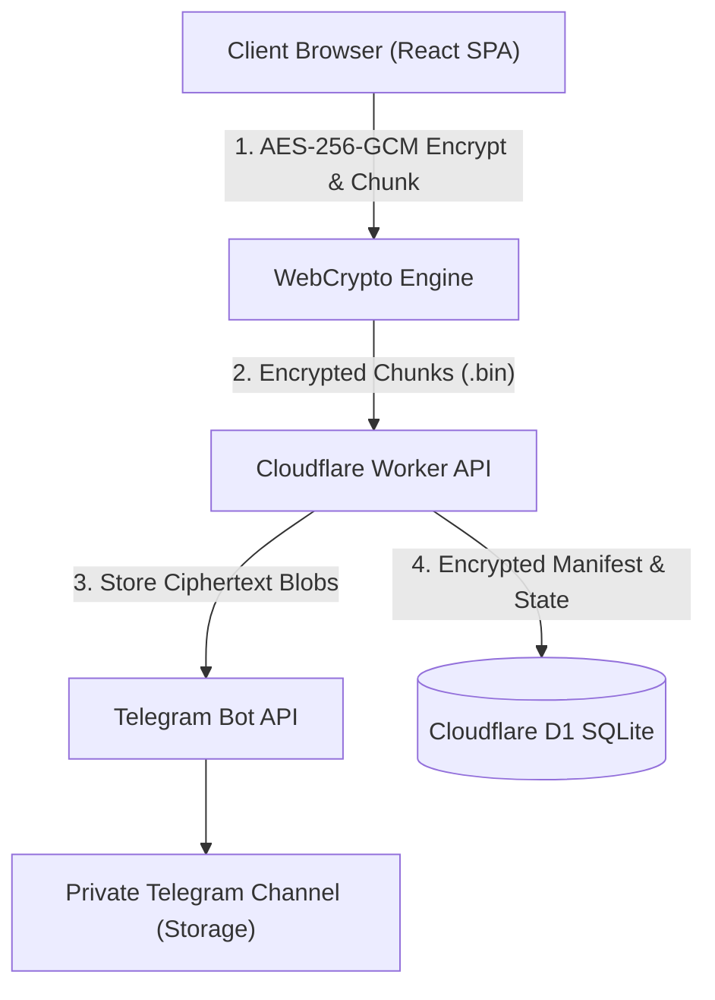

# TeleVault 🛡️📦

> **Zero-Knowledge, End-to-End Encrypted Photo & Video Vault Backed by Telegram & Cloudflare**

TeleVault is a personal media library and archival system designed with strict zero-knowledge cryptography. Your photos and videos are encrypted client-side in your browser before leaving your device, split into deterministic chunks, and stored anonymously inside a private Telegram channel. Cloudflare Workers and D1 database handle metadata coordination and snapshot caching without ever seeing your encryption keys or media plaintext.

---

## 🌟 Highlights

- **Zero-Knowledge Architecture:** Master passphrase and derived encryption keys never leave your browser.
- **Client-Side AES-256-GCM:** Pure WebCrypto API (PBKDF2 HMAC-SHA256 >= 600,000 rounds, HKDF subkey derivation).
- **Unlimited Free Storage:** Uses your private Telegram channel as an encrypted, distributed blob store (20 MB chunk size, well within Bot API limits).
- **Zero Plaintext Telegram Metadata:** Telegram sees only random UUID `.bin` files (`d290f1ee-6c54-4b01-90e6-d701748f0851.bin`). Zero captions, zero original filenames, zero EXIF data.
- **Disaster Recovery & Pinned Backups:** If the Cloudflare D1 database vanishes, your entire library can be reconstructed strictly from Telegram channel history using your Emergency Kit.
- **Edge Performance:** Fast previewing with encrypted thumbnail generation, infinite scrolling timeline grid, and responsive lightbox with pinch-to-zoom.
- **100% Free Tier Deployable:** Built to run permanently within Cloudflare Workers Free Tier and Telegram's free Bot API.

---

## 🏗️ Architecture



For in-depth architectural specifications, see [docs/ARCHITECTURE.md](docs/ARCHITECTURE.md).

---

## 🔒 Cryptographic Specification

| Component | Standard / Parameter | Purpose |
| :--- | :--- | :--- |
| **KDF** | PBKDF2 HMAC-SHA256 (600,000 iterations, 32-byte salt) | Key derivation from master passphrase |
| **Subkey HKDF** | HKDF SHA-256 | Derives distinct subkeys for chunks, manifests, and search hashes |
| **Cipher** | AES-256-GCM (12-byte random IV, 16-byte authentication tag) | Symmetric encryption of all media, thumbnails, and metadata |
| **Search Index** | HMAC-SHA256 blind indexing | Allows encrypted filtering without exposing search terms |

For full cryptographic analysis, proofs, and NIST test vector validation, see [docs/CRYPTO.md](docs/CRYPTO.md).

---

## 🚀 Quick Start (Local Development)

### 1. Prerequisites
- Node.js 20+ and npm 10+
- A Telegram Bot Token from [@BotFather](https://t.me/BotFather)
- A Private Telegram Channel with your bot added as Admin

### 2. Installation
```bash
git clone git@github.com:uATrisk/tele-vault.git
cd tele-vault
npm install
```

### 3. Run Pre-flight Diagnostics
Verify your bot credentials and channel setup:
```bash
npm run doctor
```

### 4. Run Smoke Test
Test end-to-end encryption, Telegram roundtrip, and cleanup:
```bash
npm run live-smoke
```

### 5. Launch Local Dev Stack
```bash
npm run dev
```
Open **`http://localhost:5173`** in your browser.

- Enter your generated **Web Access Token** (stored in `.dev.vars`).
- Create your Master Passphrase in the Setup Wizard.
- Save your Emergency Recovery Kit.

---

## ☁️ Production Deployment (Cloudflare)

Deploy to Cloudflare Workers with zero infrastructure costs:

1. **Log in to Cloudflare:**
   ```bash
   npx wrangler login
   ```

2. **Create D1 Database:**
   ```bash
   cd apps/worker
   npx wrangler d1 create televault-db
   ```
   Copy the `database_id` into `apps/worker/wrangler.toml`.

3. **Deploy:**
   ```bash
   cd ../..
   npm run deploy
   ```

---

## 🧪 Testing

TeleVault maintains a strict automated test suite:

- **Unit & Integration Tests:**
  ```bash
  npm run test:all
  ```
  Runs TypeScript typechecks, 32 WebCrypto tests, and 20 Worker API integration tests.

- **Playwright End-to-End Suite:**
  ```bash
  npm run test:e2e
  ```
  Verifies the complete user journey (login, encryption, multi-chunk upload, lightbox viewing, locking, session restore, accessibility).

- **Secret Leakage Scanner:**
  ```bash
  npm run test:secrets
  ```
  Ensures no tokens, private keys, or `.dev.vars` files are committed.

---

## 📜 Documentation

- [Architecture & Data Flow](docs/ARCHITECTURE.md)
- [Cryptographic Primitives & Derivations](docs/CRYPTO.md)
- [Threat Model & Security Guarantees](docs/THREAT_MODEL.md)
- [Disaster Recovery & Off-Grid Restore](docs/RECOVERY.md)
- [Platform Limits & Quotas](docs/LIMITS.md)
- [API Reference](docs/API.md)
- [Manual Verification Checklist](docs/MANUAL_TEST_CHECKLIST.md)

---

## 📄 License

MIT License. Designed and built for private, sovereign personal data ownership.
